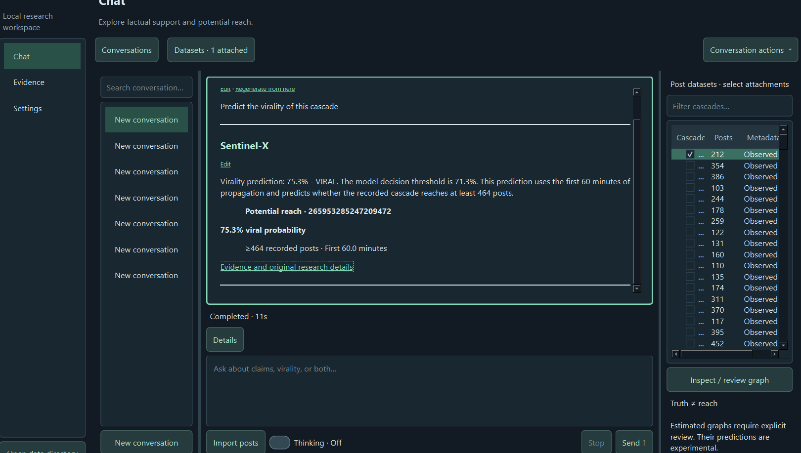

# Sentinel-X

This working branch uses quantized Transformers generation with mandatory Qwen-Scope.
Models offers both 9B and 2B paired downloads and explicit CPU offloading.
See [Scope configuration and validation status](docs/SCOPE.md). Memory fit and
full-model execution are not yet validated; release packaging remains unfinished.

**Quick start:** run `python run.py setup`, then `python run.py`
(use `python3` on Linux/macOS or `py -3.13` on Windows).

**Docker desktop:** [Build locally for CPU or NVIDIA CUDA](docs/container.md).
Separate local images include a password-protected browser desktop, authenticated
conversation downloads, and persistent Scope settings/model storage. Downloads
require opt-in networking; no application images are published or pulled.
Container builds and real-model memory fit still require Docker-host validation.
See [setup.md](setup.md) for prerequisites, model downloads, and checkpoint setup.

Project layout: application code is in `src/backend/sentinel_x/`, automation in
`scripts/`, tests in `tests/`, and supporting documentation in `docs/`. Versioned
GraphSAGE checkpoints belong in `model weights/`; feature tables and experiment
summaries belong in `results/`. The `.venv/` environment and downloaded models are
local setup artifacts.

**Sentinel-X** is a local AI research application for studying two different questions about social-media content:

1. **Is there evidence supporting the claims being made?**
2. **How likely is the content to spread widely?**

The project keeps these questions separate because a post can become viral even when it is false, and a true post may never spread widely.

Sentinel-X combines a local Large Language Model (**Qwen3.5-9B**) with a Graph Neural Network (**GraphSAGE**). Qwen analyzes the meaning and framing of a post, while GraphSAGE analyzes how the post spreads through a propagation network. The final application brings evidence analysis and virality prediction together in a desktop research workspace.

---

## Project Goal

The main research question behind Sentinel-X is:

> **Can semantic information extracted by an LLM improve early virality prediction beyond propagation structure alone?**

To investigate this, the project uses the **Twitter15** and **Twitter16** rumor-propagation datasets. The model observes only the early part of a cascade and attempts to predict whether the recorded cascade will eventually become large.

The final system supports a hybrid workflow:

```text
Social-media post / cascade
          |
          +--------------------------+
          |                          |
          v                          v
      Qwen3.5-9B                Propagation graph
   semantic analysis                  |
          |                           v
          |                       GraphSAGE
          |                           |
          +------------+--------------+
                       |
                       v
              Virality prediction
                       |
                       v
                Sentinel-X GUI
```

---

## What Sentinel-X Does

Sentinel-X provides three main capabilities.

### 1. Local Evidence Analysis

The application can search locally indexed evidence and use Qwen to help assess factual claims. Evidence results are kept separate from virality predictions so that model-estimated spread is never presented as proof that a claim is true.

### 2. Propagation Graph Analysis

Imported social-media posts are represented as propagation graphs. Nodes represent posts/users in a cascade and edges represent observed propagation relationships.

The application validates these graphs before they are used for prediction. The Twitter15/16 ingestion pipeline also repairs malformed propagation structures where possible, including duplicate edges and problematic relationships.

### 3. Early Virality Prediction

GraphSAGE analyzes the observed propagation structure during the **first 60 minutes** of a cascade.

For the final hybrid model, Qwen additionally extracts a semantic score from the source post. This semantic information is combined with the GraphSAGE representation before the final virality decision is produced.

---
## 🖥️ Live Sentinel-X Demo

The final Sentinel-X application performs the complete hybrid prediction pipeline locally:

**Qwen3.5-9B → Semantic Feature Extraction → GraphSAGE → Virality Prediction**



### Example Prediction

In the example above, Sentinel-X analyzes an observed Twitter15 propagation cascade containing 212 posts.

- **Viral probability:** 75.3%
- **Decision threshold:** 71.3%
- **Prediction:** VIRAL
- **Observation window:** First 60 minutes
- **Virality target:** ≥464 recorded posts
- **Selected semantic feature:** Emotional language
- **Model:** Qwen-enhanced GraphSAGE

The semantic signal is extracted using Qwen3.5-9B, while GraphSAGE analyzes the observed propagation structure. The final probability shown in the interface comes from the trained hybrid model rather than being generated by the conversational LLM.

---
# System Architecture

The project is designed as a local desktop application. The main components are:

```text
Sentinel-X Desktop UI
        |
        v
Application Service Layer
        |
        +--------------------+
        |                    |
        v                    v
 Local Qwen Runtime      Graph Processing
        |                    |
        |                    v
        |                GraphSAGE
        |                    |
        +---------+----------+
                  |
                  v
          Prediction / Analysis
                  |
                  v
          Stored Conversations,
          Evidence and Results
```

Important project modules include:

- `assistant.py` - coordinates chat, evidence analysis, semantic extraction and virality requests.
- `graphs.py` - graph ingestion, validation, repair, normalization and graph features.
- `learning.py` - GraphSAGE training, evaluation, baselines, ablation support and prediction.
- `runtime.py` - isolated Qwen + Scope worker communication.
- `service.py` - application services, imports, jobs, models and graph storage.
- `trainer.py` - separate GraphSAGE training interface.
- `skills.py` - controlled tool registration for evidence search and GraphSAGE prediction.
- `cli.py` - command-line entry points for the GUI, training, prediction and indexing.

---

# Datasets

## Twitter15

Initial cascades: **1,490**  
Valid cascades after validation/repair: **1,487**

Cascade-size statistics:

- Minimum: 56 posts
- Median: 260 posts
- Mean: 400.13 posts
- 75th percentile: 464 posts
- 90th percentile: 818.2 posts
- Maximum: 2,990 posts

The final Twitter15 experiments define a large/viral recorded cascade as one reaching at least **464 posts**.

## Twitter16

Initial cascades: **818**  
Valid cascades after validation/repair: **816**

Cascade-size statistics:

- Minimum: 74 posts
- Median: 271 posts
- Mean: 424.04 posts
- 75th percentile: 474.25 posts
- 90th percentile: 929.5 posts
- Maximum: 3,089 posts

The final Twitter16 experiments use a threshold of **475 posts**.

These thresholds are based on recorded cascade size in the datasets. They should not be interpreted as worldwide lifetime reach.

---

# Graph Validation and Repair

One of the important implementation challenges was handling the raw Twitter propagation graphs.

Initially, hundreds of Twitter15 cascades were rejected because the raw relationships produced cycles. Sentinel-X was updated to process and repair these propagation structures while preserving valid observed information.

The final ingestion pipeline performs tasks such as:

- validating node IDs;
- removing duplicate edges;
- checking that edges reference existing nodes;
- repairing problematic Twitter propagation relationships;
- detecting remaining cycles;
- identifying roots;
- validating propagation delays; and
- rejecting graphs that still cannot form a valid connected cascade.

After these changes, **1,487/1,490 Twitter15 cascades** and **816/818 Twitter16 cascades** were usable.

---

# GraphSAGE Virality Model

Sentinel-X uses a graph-level **GraphSAGE** classifier.

Each cascade is truncated to the first **60 minutes** before features are created. This prevents the model from using information that occurs later in the cascade when making an early prediction.

Node features include structural and temporal information derived from the observed prefix, such as normalized propagation delay, parent/child information and graph depth.

The GraphSAGE network performs neighborhood aggregation and produces a graph representation using global mean pooling. A final classifier converts this representation into a virality probability.

The decision cutoff is selected using validation data rather than automatically assuming a probability threshold of 0.5.

---

# Qwen Semantic Analysis

The project uses a local **Qwen3.5-9B** model through a quantized Transformers worker with mandatory Scope analysis.

Qwen was used to extract five semantic characteristics from source tweets:

1. **Urgency** - pressure to react, share or act immediately.
2. **Sensationalism** - exaggerated or attention-grabbing presentation.
3. **Emotional language** - wording intended to trigger a strong emotional reaction.
4. **Authority framing** - reliance on experts, institutions or authority figures.
5. **Conspiracy framing** - suggestions of secrecy, suppression, hidden actors or cover-ups.

The semantic values are numerical scores between `0.0` and `1.0`.

Features were generated for the source tweets in both datasets, covering **2,308 Twitter15/16 source tweets** in total.

---

# LLM + GNN Fusion

The GraphSAGE representation can be combined with Qwen semantic features before classification.

Conceptually:

```text
Qwen semantic feature(s)
          |
          +------------------+
                             |
Propagation graph            |
       |                     |
       v                     |
   GraphSAGE                 |
       |                     |
       +----------+----------+
                  |
                  v
           Final classifier
                  |
                  v
        Virality probability
```

The project tested both:

- all five semantic features together; and
- each semantic feature individually through an ablation study.

This was important because adding more LLM information did **not** automatically improve prediction quality.

---

# Experimental Setup

Final experiments used:

- Observation window: **60 minutes**
- Twitter15 threshold: **464 recorded posts**
- Twitter16 threshold: **475 recorded posts**
- Training seed: **42**
- GNN: **GraphSAGE**
- LLM: **Qwen3.5-9B**
- Training: **PyTorch**
- GPU acceleration: **NVIDIA CUDA**

The development machine successfully ran CUDA-enabled PyTorch on an **NVIDIA GeForce RTX 3050 Ti Laptop GPU**.

Two simple baselines were also evaluated:

- **Majority baseline** - always predicts the majority class.
- **Observed-size baseline** - predicts using the number of posts already observed during the early window.

---

# Final Experimental Results

| Dataset | Model | Semantic Feature(s) | F1 | Accuracy | Precision | Recall | PR-AUC |
|---|---|---|---:|---:|---:|---:|---:|
| Twitter15 | GraphSAGE | None | 76.79% | 88.34% | 76.79% | 76.79% | **85.54%** |
| Twitter15 | GraphSAGE + Qwen | All 5 | 74.07% | 87.44% | 76.92% | 71.43% | 84.79% |
| Twitter15 | GraphSAGE + Qwen | Urgency | 75.23% | 87.89% | 77.36% | 73.21% | 84.23% |
| Twitter15 | GraphSAGE + Qwen | Sensationalism | 75.21% | 87.00% | 72.13% | **78.57%** | 85.10% |
| Twitter15 | GraphSAGE + Qwen | **Emotional language** | **79.28%** | **89.69%** | **80.00%** | **78.57%** | 84.42% |
| Twitter15 | GraphSAGE + Qwen | Authority framing | 75.00% | 87.44% | 75.00% | 75.00% | 84.21% |
| Twitter15 | GraphSAGE + Qwen | Conspiracy framing | 78.18% | 89.24% | 79.63% | 76.79% | 85.22% |
| Twitter16 | GraphSAGE | None | **73.68%** | 87.80% | 80.77% | 67.74% | 77.04% |
| Twitter16 | GraphSAGE + Qwen | All 5 | **73.68%** | 87.80% | 80.77% | 67.74% | 76.87% |
| Twitter16 | GraphSAGE + Qwen | Emotional language | **73.68%** | 87.80% | 80.77% | 67.74% | **77.27%** |

---

# What We Learned

## 1. Propagation structure is already a strong signal

Graph-only GraphSAGE performed well on both datasets. Early propagation behavior therefore contains substantial information about eventual recorded cascade size.

## 2. More semantic features are not automatically better

Combining all five Qwen features did not improve the graph-only model.

On Twitter15:

```text
Graph-only F1:       76.79%
All-five Qwen F1:    74.07%
```

On Twitter16:

```text
Graph-only F1:       73.68%
All-five Qwen F1:    73.68%
```

This suggests that some semantic signals can add noise when they are combined without feature selection.

## 3. Emotional language was the strongest Twitter15 semantic feature

Adding only emotional language improved Twitter15:

```text
F1:        76.79% -> 79.28%
Accuracy:  88.34% -> 89.69%
Precision: 76.79% -> 80.00%
Recall:    76.79% -> 78.57%
```

Conspiracy framing also improved Twitter15 F1 to **78.18%**.

## 4. The improvement did not fully generalize

On Twitter16, emotional-language fusion produced the same F1 as graph-only GraphSAGE:

```text
Graph-only F1:          73.68%
+ Emotional language:   73.68%
```

PR-AUC increased slightly from **77.04% to 77.27%**, but classification performance was unchanged.

Therefore, the project does **not** claim that LLM features universally improve GNN virality prediction.

The stronger conclusion is:

> **LLM-derived semantic information can complement propagation-based virality prediction, but its usefulness is feature- and dataset-dependent.**

---

# Final Live Pipeline

The final Sentinel-X application uses the selected Twitter15 emotional-language model for the demonstration workflow.

Unlike an ordinary chatbot, Sentinel-X does not allow Qwen to invent a virality probability.

For a virality request, the application controls the sequence:

```text
User asks for virality prediction
             |
             v
Application forces prediction pipeline
             |
             v
Qwen extracts emotional_language
             |
             v
GraphSAGE analyzes 60-minute propagation graph
             |
             v
GraphSAGE returns actual probability
             |
             v
Python formats deterministic result
             |
             v
Sentinel-X GUI
```

This design is important because virality probabilities come from the trained model rather than from free-form LLM generation.

---

# Successful Live Demonstration

A real imported Twitter15 cascade was used for the final end-to-end test.

Cascade ID:

```text
265953285247209472
```

The cascade contained **212 recorded posts**.

Sentinel-X returned:

```text
Virality prediction: 75.3% - VIRAL
Decision threshold:   71.3%
Observation window:   First 60 minutes
Target threshold:     >=464 recorded posts
Model:                GraphSAGE + Qwen emotional language
```

The GUI displayed:

> **75.3% viral probability**  
> ≥464 recorded posts · First 60.0 minutes

This verifies the complete local LLM-GNN prediction pipeline.

---

# Evidence and Virality Are Separate

Sentinel-X intentionally treats factual evidence and propagation prediction as separate outputs.

A GraphSAGE probability means:

> *The trained model estimates that this propagation pattern is likely/unlikely to reach the configured recorded-cascade threshold.*

It does **not** mean:

> *The content is true.*

Likewise, evidence supporting a factual claim does not guarantee that the claim will become viral.

This separation is an important part of the project's information-assurance design.

---

# Installation

See [setup.md](setup.md) for the cross-platform Python setup script, local model
checkpoint installation, and Windows, macOS, and Linux launch instructions.
Local model pairs go in [`model weights/`](model%20weights/README.md).

## Requirements

Recommended environment:

- Windows 10/11
- Python 3.13 used during development
- NVIDIA GPU recommended for training
- CUDA-compatible PyTorch for GPU training
- Sufficient disk space for Qwen model weights and optional evidence resources

Clone the repository and move into it:

```powershell
git clone <repository-url>
cd 543-research-project
```

Install the project dependencies according to the repository's Python dependency configuration.

To verify CUDA-enabled PyTorch:

```powershell
python -c "import torch; print('PyTorch:',torch.__version__); print('CUDA:',torch.cuda.is_available()); print('GPU:',torch.cuda.get_device_name(0) if torch.cuda.is_available() else 'None')"
```

During development the working environment reported:

```text
CUDA available: True
GPU: NVIDIA GeForce RTX 3050 Ti Laptop GPU
```

---

# Running Sentinel-X

Start the desktop application from the repository root:

```powershell
python -m sentinel_x.cli gui
```

The Models screen offers 9B and 2B downloads, each with its matching Scope SAE, plus device and CPU-offload selection.

---

# Training GraphSAGE

Graph-only Twitter15 example:

```powershell
python -m sentinel_x.cli train datasets/twitter15 --threshold 464 --window 60 --epochs 30 --seed 42 --device cuda
```

Graph-only Twitter16 example:

```powershell
python -m sentinel_x.cli train datasets/twitter16 --threshold 475 --window 60 --epochs 35 --seed 42 --device cuda
```

The CLI also supports Qwen semantic feature files and individual-feature ablation testing.

Example emotional-language experiment:

```powershell
python -m sentinel_x.cli train datasets/twitter15 --threshold 464 --window 60 --epochs 30 --seed 42 --device cuda --llm-features results/twitter15_llm_features.json --llm-feature emotional_language
```

---

# Semantic Feature Ablation

Supported individual features are:

```text
urgency
sensationalism
emotional_language
authority_framing
conspiracy_framing
```

Example:

```powershell
python -m sentinel_x.cli train datasets/twitter15 --threshold 464 --window 60 --epochs 30 --seed 42 --device cuda --llm-features results/twitter15_llm_features.json --llm-feature conspiracy_framing
```

This functionality was used to determine which semantic dimensions actually contributed useful information instead of assuming all LLM features were beneficial.

---

# Important Final Checkpoint

The selected Twitter15 emotional-language demonstration checkpoint is:

```text
fe44637dfc4d49fe9cd402c4ce6cc21d
```

Model variant:

```text
graphsage_qwen_ablation
```

Required semantic feature:

```text
emotional_language
```

---

# Final Results Files

Final research outputs are organized under:

```text
results/final/
```

Important files include:

```text
experiment_results.csv
model_configuration.json
final_findings.md
checkpoint_map.json
sentinel_x_live_prediction.png
```

These files are intended to provide one consistent source for the final report, README and presentation.

---

# Limitations

Sentinel-X is a research prototype, and its results should be interpreted accordingly.

Important limitations include:

- Virality represents **recorded cascade size**, not worldwide lifetime reach.
- Twitter15 and Twitter16 are historical datasets.
- Qwen semantic scores are model-generated rather than human-annotated labels.
- The emotional-language improvement observed on Twitter15 did not reproduce as an F1 improvement on Twitter16.
- Only five selected semantic dimensions were evaluated.
- Other text representations or fusion methods may produce different results.
- Propagation graph repair may affect downstream graph features.
- A virality prediction is not a factual truth assessment.
- The application is designed for research and experimentation rather than production moderation or real-world deployment.

---

# Key Takeaway

Sentinel-X demonstrates that **content and propagation can be analyzed together without treating them as the same problem**.

GraphSAGE captures **how information spreads**, while Qwen captures selected aspects of **what the content says and how it is framed**.

The experiments showed that propagation structure remains a strong predictor by itself. Carefully selected semantic information can provide additional value, but simply adding more LLM-generated features does not guarantee better performance.

The final result is a working local research application that connects:

**evidence analysis + semantic LLM analysis + graph neural networks + early virality prediction**.

---

## Project Status

**Final research implementation complete.**

- Twitter15/16 ingestion and graph repair: complete
- GraphSAGE baseline: complete
- GPU training: complete
- Qwen semantic extraction: complete
- LLM-GNN fusion: complete
- Five-feature fusion experiment: complete
- Semantic ablation study: complete
- Cross-dataset evaluation: complete
- Live Qwen + GraphSAGE inference: complete
- Deterministic virality output: complete
- Final results package: complete

