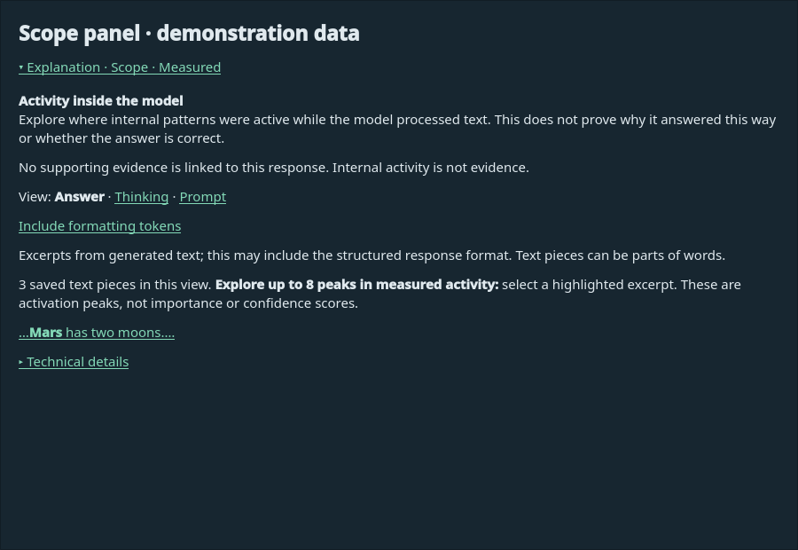

# Scope branch: model downloads and placement

Models now offers both **Qwen3.5-9B + matching Scope SAE** and
**Qwen3.5-2B + matching Scope SAE** download buttons. Downloads are independent
of model selection and do not activate a model. Both pairs may coexist in app
storage. The selector determines which pair is loaded; 2B is an explicit
fallback, not a silent substitution after a failed 9B request.

Each pair uses layer 16, residual output, Top-K 50. 9B uses 32 layers, hidden
size 4096 and SAE width 65536; 2B uses 24 layers, hidden size 2048 and SAE width
32768. The committed artifact manifest pins revisions and checksums for both.
The weights downloaded are the official Transformers weights; NF4 quantization
with double quantization happens during loading, not during download. Download
size therefore exceeds the eventual quantized resident weight size.

Device choices are CPU, NVIDIA CUDA, and AMD ROCm. GPU placement choices are:

- No CPU offloading: Qwen and the Scope encoder run on the selected GPU backend.
- Scope SAE on CPU: generation stays on the GPU; bounded residual batches move to
  CPU for sparse feature extraction.
- Scope and selected Qwen modules on CPU: embeddings, output head and vision
  modules stay on CPU; decoder layers and final normalization stay on the GPU.
  CPU-dispatched modules may be unquantized and consume substantial RAM.

The offload preference is retained but inactive in CPU-only mode. Selection and
placement changes stop the old worker. All generation requires Scope; changing
placement never enables an uninstrumented chat runtime.

ROCm requires a HIP-enabled PyTorch build and compatible bitsandbytes. The worker
checks a small NF4 calculation before loading the full model and records the
selected backend. See [ROCm setup and validation](ROCM.md).

The native app imposes no estimated-memory admission checks, GPU allocator cap,
or combined application/worker RAM budget. It attempts loading and generation
and reports actual failures. Backend compatibility checks remain enabled. Use
CPU offloading, a smaller model, or less context if an allocation fails. If the
OS kills the worker, the app reports an unexpected worker exit rather than a
Python allocation error. Full-model memory usage still needs measurement.

The Thinking panel contains only emitted thinking. Explanation · Scope contains
measured feature IDs, values and associated tokens, regardless of Thinking.
Completed panels start collapsed and expand independently. Feature descriptions
are not invented. Saved records include the actual model/SAE revisions,
quantization, device, offload choice, call boundary, token positions and capture
status. Edited responses retain analysis labeled as original-response analysis.

Generation stops on either the model generation config's EOS IDs or the
tokenizer's EOS ID. For the installed Qwen model, the model config names
`<|endoftext|>` while the chat tokenizer names `<|im_end|>`. Both are generation
boundaries and are excluded from streamed answers and JSON parsing. Other text,
including function-call tags, is preserved. JSON is still parsed strictly; this
does not salvage truncated objects or substitute semantic scores.

Completed generation records also retain `output_text`, `thinking_text`,
`stop_token_ids`, and `finish_reason` so malformed-output failures can be inspected
even when sparse token capture reaches its limit. Auxiliary extraction now follows
the conversation Thinking setting, which defaults to On. Older extraction records
may have empty thinking text. Older records may lack
these fields; their token IDs and phases can reconstruct captured output.
Markdown exports include the sparse records. Older messages gain no invented
measurements.

SAEs were trained on base checkpoints. Their application to quantized
conversational checkpoints is experimental; activations are not independently
validated causal explanations and do not explain GraphSAGE internals. Published
research metrics must not be assumed to transfer to either model configuration.

Settings reset clears model/device/offload preferences and preserves both pairs.
Factory reset removes downloaded pairs within application storage. Obsolete
GGUF and llama.cpp files are ignored and preserved during ordinary upgrades.

Validation: 193 tests pass offline, including native evaluation-folder imports,
model selection, ROCm admission and
device routing, paired downloads, offload maps, activation math, capture,
conversation storage, exports and existing retrieval/GraphSAGE tests.
A real bitsandbytes 0.50.2 NF4
linear layer executed on CPU. Neither complete 9B nor complete 2B loading and
inference has been measured against the memory targets. CUDA validation remains
blocked by driver access. The earlier frozen startup check failed on a PyTorch
shared-library dependency; release packaging remains unfinished.

On 2026-11-05, replaying the failed Case 01 request in isolated app storage
loaded the real 9B/SAE pair on the RX 9070 XT with ROCm and SAE CPU offloading.
The semantic extraction parsed on its first attempt with complete Scope capture,
and GraphSAGE returned the spread prediction. The saved failure had contained a
valid semantic JSON object followed by `<|im_end|>`; recognizing the tokenizer's
EOS fixed this without changing the model's score. This virality-only workflow
formats its final response programmatically. It does not validate general chat,
the 2B pair, prediction quality, or peak-memory targets.

## Readable activity view

The expanded Scope panel now defaults to answer text from the latest response
or formatting step. It shows up to eight activation peaks as clickable excerpts
with nearby text, suppressing overlapping excerpts. These are measured peaks,
not importance, confidence, or causal rankings. Answer, Thinking, and Prompt
views are independent of the Thinking trace dropdown. Model-step links separate
auxiliary calls from response calls. Whitespace, punctuation-only text pieces
and control markers are hidden by default; Include formatting tokens restores
them for inspection. Structured answer text may still contain JSON field names.

Select an excerpt to inspect its saved text piece. Technical details is collapsed
by default and shows the strongest 20 features for the current view or selected
piece, along with provenance and failure details. Feature meanings are explicitly
unestablished; the UI supplies no invented descriptions. Evidence and research
details are linked separately when present. Missing and partial captures are
labeled; empty views are never interpreted as absence of a feature.

Selections and expansion states survive transcript refreshes in the current
window. Edited answers show the original-analysis notice. This is a presentation
change only: all original sparse records remain intact, including hidden tokens,
and Markdown export retains its complete measurement records.

## Complete prediction reporting

Virality requests now continue to Qwen interpretation after GraphSAGE completes.
The report includes checkpoint identity, first-window node/edge counts, actual
semantic inputs, probability/cutoff/class, target and preprocessing warnings.
The model explains the claim, framing and evidence limitations; its narrative is
kept alongside the application-generated numerical report. Scope summaries come
directly from saved runtime metadata, including capture and Thinking-budget limits;
Qwen cannot substitute propagation counts for activation measurements in that section.
Raw model output is retained for review. Model context includes
source text and computed early-window results, excluding final cascade size,
rumor labels and later post previews. Thinking defaults On in Settings → Models.
See [Case 01 pilot review](CASE01_REVIEW.md) for the measured false negative,
missing report content, prompt revision and limits on research claims.

Generation now reserves the configured Thinking allowance separately from the
answer allowance. Raising Thinking no longer reduces final-answer space. Scope
records retain both budgets and GPU allocation/reservation peaks on CUDA/ROCm.
The [research workflow](research/README.md) versions this change and preserves
earlier failed pilot attempts.
