# Main workspace

The assistant uses three primary destinations: Chat, Evidence, and Settings. Models and Skills are tabs inside Settings; Background work opens the job monitor. The separate GraphSAGE trainer remains available from Settings → Models.

## Chat and thinking

**Import posts** offers **Twitter15 / Twitter16 input folder…** for native data
and evaluation case `input/` folders, and **JSON / JSONL file…** for post files.
Native imports validate cascades in the background and attach successful ones
to the originating conversation. The dataset drawer opens with them checked;
switching conversations during import saves those attachments in the original
draft. Reimporting the same native cascade updates it without a duplicate.
Rejected cascades are counted in the completion message with details in
Background work. Native imports require no Trainer, model inference, or field
mapping. JSON/JSONL imports retain their preview and field-mapping dialog.

The conversation list and dataset drawer can be collapsed. At narrow widths, opening either panel closes the other to preserve composer space. Drafts and attachments belong to individual conversations.

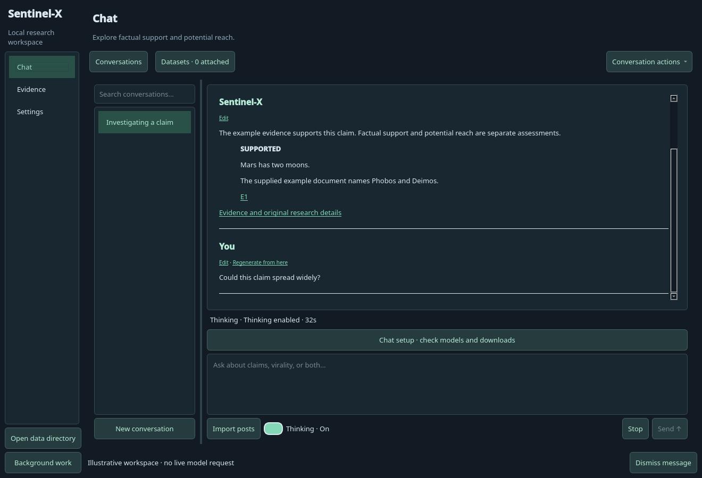

Thinking defaults to On for new conversations. Its On/Off control is in Settings → Models, and changes apply to the current conversation’s next request. Explicit draft choices are preserved. Generation status reports actual stages and elapsed time; it does not invent a percentage. “Thinking enabled” records the submitted setting, while “Thinking” identifies reasoning activity reported by the runtime. Stop remains accessible while work is active. Answers stream as clearly labeled drafts before final claim/citation validation, even with Thinking Off. Thinking streams inside an expandable dropdown. It collapses to **Thought for …** on completion; clicking that row reopens the saved local-model trace. Completed answers retain up to 64,000 characters across restarts, with truncation labeled. Earlier responses whose traces were discarded cannot recover them. If the model emits no separate trace, the answer states that explicitly. The default 256-token thinking limit is configurable in Advanced settings.

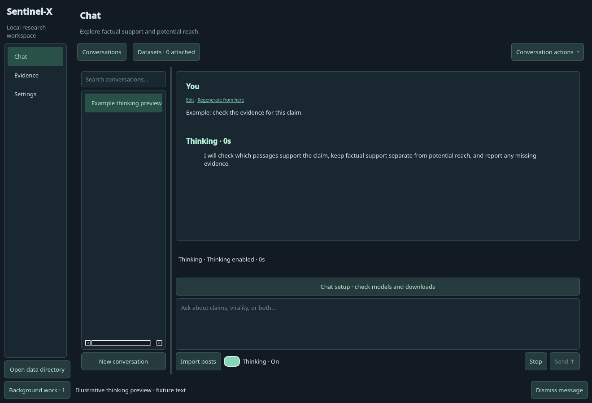

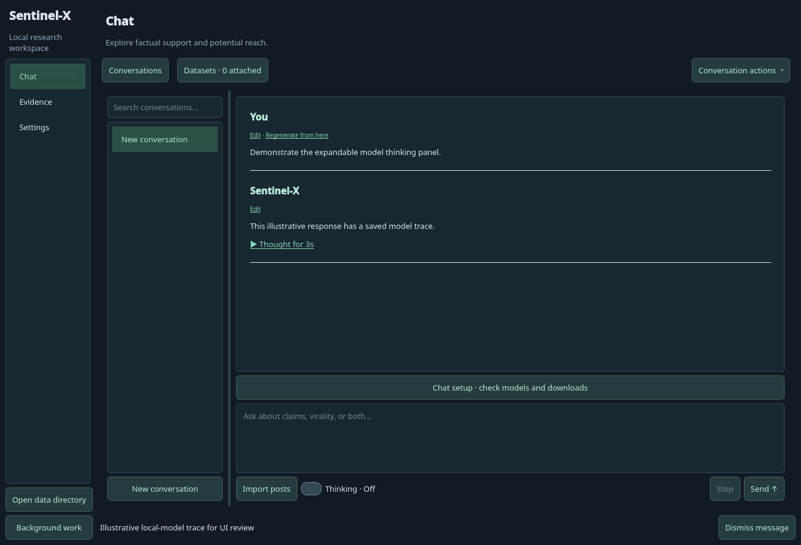

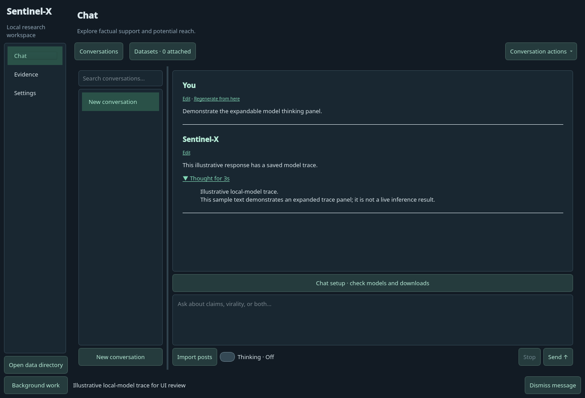

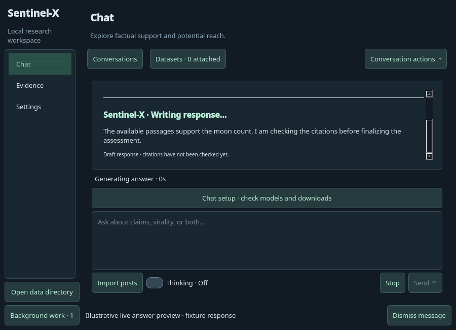

## Message editing

Both user messages and assistant answers have an Edit action. Save changes retains earlier text in revision history and labels later messages as based on an earlier version. Original evidence, assessments, prompts, and execution records remain available. Regenerate from here preserves the original thread and starts a separate conversation.

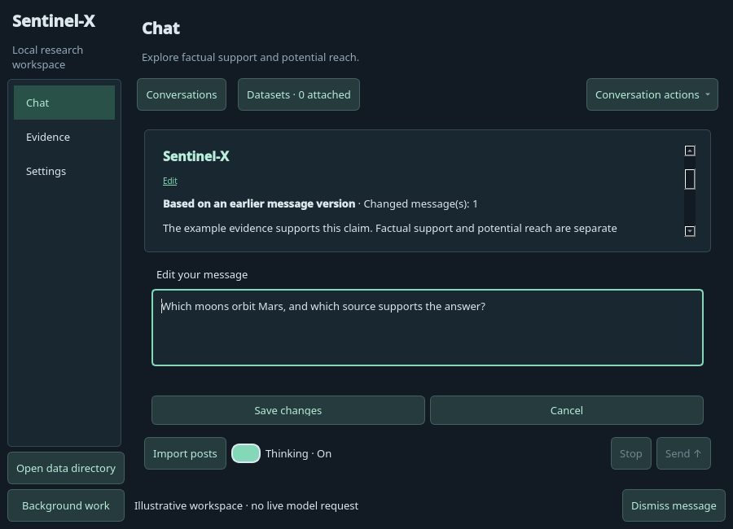

FEVER setup defaults to saving the archive without extraction or indexing. Evidence has separate **Download FEVER only** and **Build / resume FEVER index** controls. The latter uses the saved archive offline and reuses verified extracted files. Cancel/resume preserves the download and committed batches. Newly committed passages can be used while remaining files index; unindexed text is not yet available to chat. Chat/model requests have a separate worker.

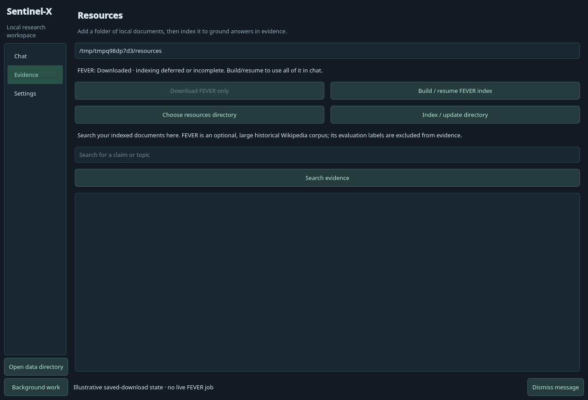

## Recovery and setup

Errors remain beside the affected conversation or import, with diagnostic details and recovery controls. Restore request repopulates the composer; replacing a nonempty draft requires confirmation. Downloads are always explicitly initiated, and setup shows readiness and retry controls. **Don’t show setup at startup again** persists across restarts. Settings → Models → Set up downloads opens it manually and lets you re-enable startup prompts. The preference and action buttons stay outside the scrollable setup content.

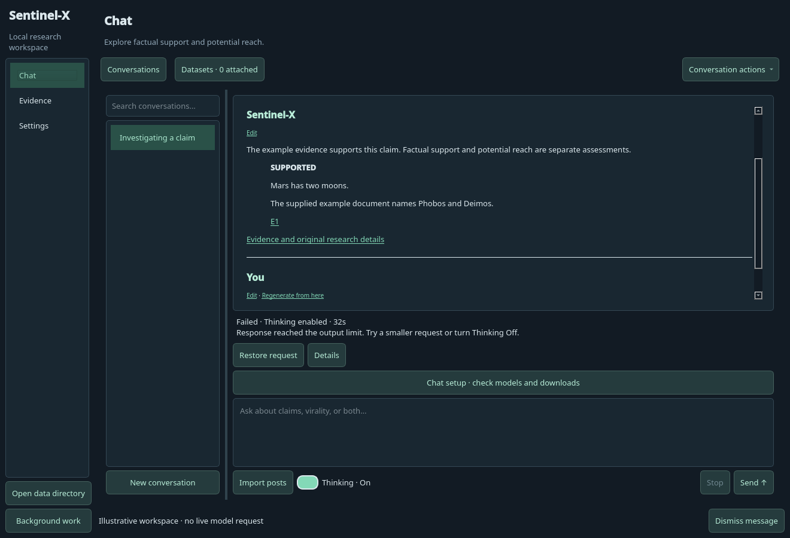

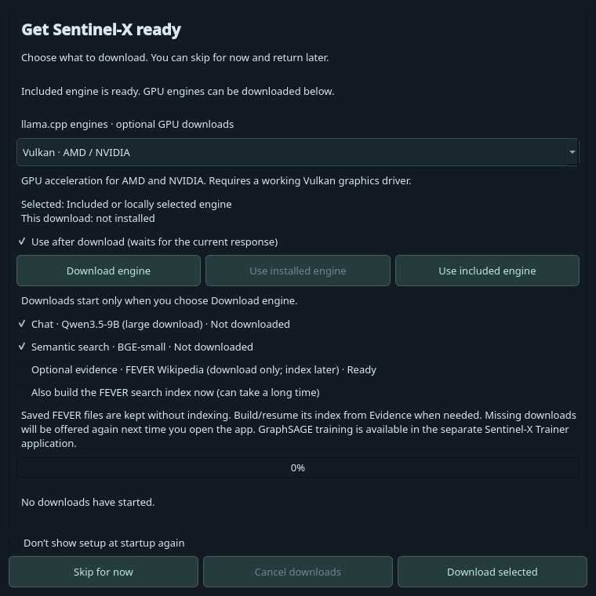

The setup dialog and Models settings share the engine selector. Vulkan, CUDA, ROCm/HIP, and CPU/Metal downloads show driver requirements, installation state, the selected engine, and download/activation progress. Activation waits for the current response and reports missing GPU devices without replacing the working engine. Download buttons are separate from the weights/evidence selection.

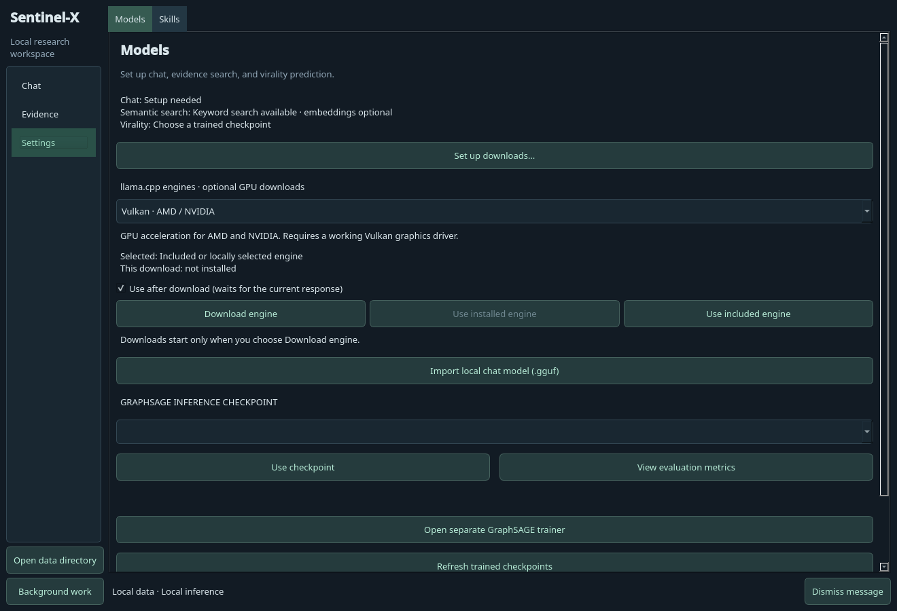

## Background work

The job monitor displays readable task names, current stages, files, byte counts, speed, estimated remaining transfer time, and elapsed time. Progress bars show measured completion for the current file or phase; indexing also reports completed files and passage counts. Select a row for a complete status summary, diagnostics, cancellation, or **Retry / resume task**. Retry keeps the original setup selections and resumes valid partial files. Opening the monitor refreshes its contents, and closing it leaves background work running.

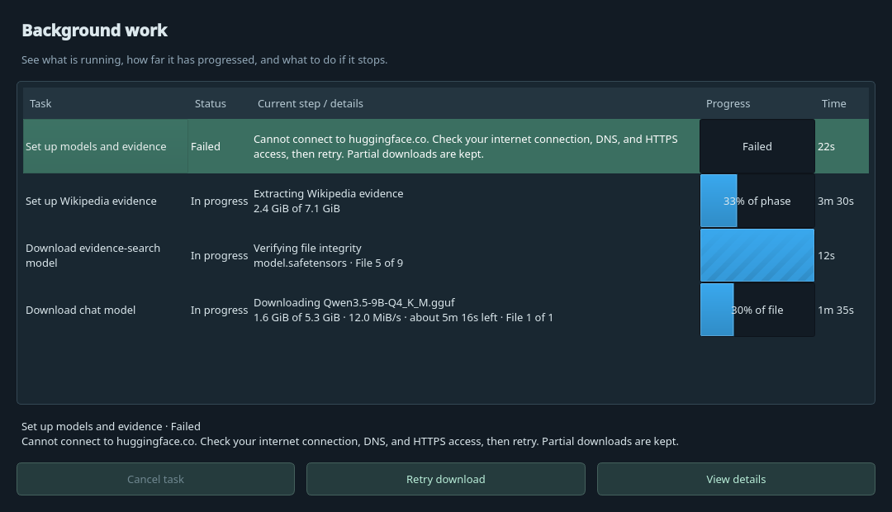

These screenshots use deterministic illustrative fixtures. They demonstrate UI states rather than live inference results. Live model verification and other limitations are recorded in [VALIDATION.md](VALIDATION.md).
